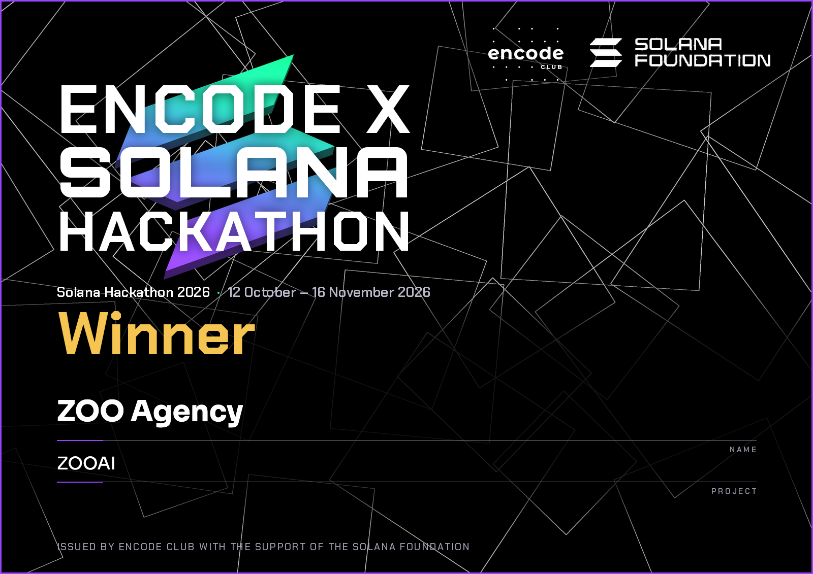
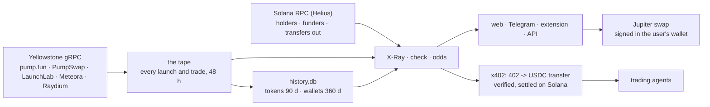
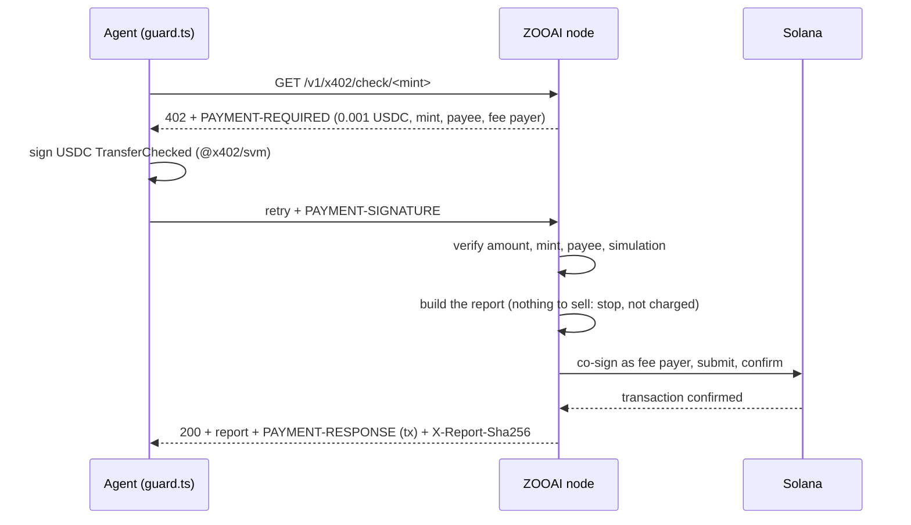

<div align="center">

<picture>
  <source media="(prefers-color-scheme: dark)" srcset=".github/assets/logo-dark.svg" />
  
</picture>

# ZOOAI AGENCY

**See who you are buying from. Live on-chain x-ray for Solana launches.**

[](#recognition)
[](#recognition)
[](https://zooaiagency.com)
[](https://x.com/zooclawagency)
[](https://t.me/zooaiagency_bot)
[](https://chromewebstore.google.com/detail/zooai-x-ray/jbkieaokkiiajaeclogolieicogbkndl)
[](LICENSE)
[](https://solscan.io/token/2dZn4npTgAexBYquT3UqQXGiBdZf4F9tDTw419jEoS6B)
[](https://github.com/0xNickdev/aiagentzoo/actions/workflows/ci.yml)

[**X-Ray**](https://zooaiagency.com/xray) · [**Live feed**](https://zooaiagency.com/feed) · [**Runner radar**](https://zooaiagency.com/radar) · [**Chrome extension**](https://chromewebstore.google.com/detail/zooai-x-ray/jbkieaokkiiajaeclogolieicogbkndl) · [**Telegram bot**](https://t.me/zooaiagency_bot) · [**API for agents**](https://zooaiagency.com/skill.md) · [**Roadmap**](https://zooaiagency.com/roadmap) · [**$ZOOAGENCY**](https://zooaiagency.com/token)

</div>

## Recognition

<p align="center"></p>

ZOOAI won **Best Consumer App on Solana** at the Encode Club x Solana Hackathon 2026 (12 October - 16 November 2026), one of the final 8.
The prize is a place in the **Encode Club x Solana accelerator**. The day after the final we cut everything that was not the x-ray: what was built, what was cut and why is on the [roadmap](https://zooaiagency.com/roadmap), each line with its commit.

## Official token

**$ZOOAGENCY** is live and trading on Solana, launched via [ClawPump](https://clawpump.tech/tokens/2dZn4npTgAexBYquT3UqQXGiBdZf4F9tDTw419jEoS6B).

```
2dZn4npTgAexBYquT3UqQXGiBdZf4F9tDTw419jEoS6B
```

[Solscan](https://solscan.io/token/2dZn4npTgAexBYquT3UqQXGiBdZf4F9tDTw419jEoS6B) · [Buy on ClawPump](https://clawpump.tech/tokens/2dZn4npTgAexBYquT3UqQXGiBdZf4F9tDTw419jEoS6B) · [DexScreener](https://dexscreener.com/solana/2dZn4npTgAexBYquT3UqQXGiBdZf4F9tDTw419jEoS6B) · [what the token does](https://zooaiagency.com/token)

## What it is

Thousands of coins launch on pump.fun every hour and almost all of them are dead a day later. Traders are going to buy anyway, but a chart cannot show who is on the other side. **ZOOAI X-Ray** can. Paste any token and in about a second you see:

- **The verdict**: avoid, caution or no red flags, with every reason in plain words and the numbers behind it.
- **The dev**: every launch they made, how many they dumped and how fast, since which day it is counted.
- **The first five seconds**: who sniped the launch, which wallets are the dev's own crew, sniper rings, serial snipers, launch bundles, and what they still hold.
- **Who paid for the dev**: the wallet that funded them, the other devs it funds, and wallets that act as one hand.
- **The money map**: funder, dev, snipers and what they sold, and **where the SOL went after the dump**.
- **The tool print**: a rugger swaps wallets, not tools. A fresh wallet launching the way a farm of dumping wallets launches gets flagged, even with no history of its own ([`fingerprint.ts`](apps/node/src/chain/fingerprint.ts)).
- **The operator**: wallets that signed one transaction together share an owner, read from the transaction's own signatures ([`operators.ts`](apps/node/src/chain/operators.ts)).
- **The odds**: the chance the coin climbs past 85 SOL market cap after minute five and the chance the dev dumps later, from two models fitted on pump.fun launches; AUC 0.89 on launches they never saw.
- **Token rights**: who can still mint, freeze, move or pause it.
- **A swap**: buy or sell right there through Jupiter, signed in your own wallet, nothing custodied. No SOL in the wallet? Fund the buy from another chain through Aurora Intents.
- **How the dev sold**: not just "sold", but when, how much they kept and whether they took back only what they put in, read against 23,184 launches ([`check.ts`](apps/node/src/chain/check.ts)).
- **One operator, many wallets**: launch wallets tied by the same funder, SOL sent between them, shared snipers or a private tool print are read as one operator with one dump record ([`opgraph.ts`](apps/node/src/chain/opgraph.ts)).
- **The links**: the X account, Telegram channel, site and GitHub a coin points to, whether they name it back, how active the repo is, and on demand an AI read of whether the code does what the coin claims ([`claims`](apps/node/src/claims)).
- **Creator fees** paid on the coin, and **early calls** by callers with a good record.
- **Coins launched before we watched**: paste any Raydium, PumpSwap, pump.fun, LaunchLab or Meteora coin and the node reads it from the chain, then follows it live ([`adopt.ts`](apps/node/src/chain/adopt.ts)).

The verdict judges a coin as it is now: a bundle counts while it holds the coin, an established coin with a live pool is read as a market rather than a launch, and with a crowd of buyers in, what most launches look like warns instead of deciding. The rules, with the data behind each: [`check.ts`](apps/node/src/chain/check.ts), [skill.md](https://zooaiagency.com/skill.md).

The same check runs in the Telegram bot [@zooaiagency_bot](https://t.me/zooaiagency_bot), in the [Chrome extension](https://chromewebstore.google.com/detail/zooai-x-ray/jbkieaokkiiajaeclogolieicogbkndl) (on GMGN, Axiom and pump.fun, and next to contract addresses on X) and in a free public API trading agents call before they buy ([`/api/check/<mint>`](https://zooaiagency.com/skill.md)).

## How Solana powers it



- **We read the chain ourselves.** A Yellowstone gRPC stream ([`apps/node/src/chain/pump.ts`](apps/node/src/chain/pump.ts), [`launchpads.ts`](apps/node/src/chain/launchpads.ts)) decodes every pump.fun, PumpSwap, Raydium LaunchLab, Meteora and Raydium AMM v4 / CPMM transaction as it lands, about 5,000 trades a minute; over 1.9 million launches and 475 million trades read so far. No third-party analytics API sits in the loop.
- **Memory.** Every launch stays on the tape for 48 hours; [`history.ts`](apps/node/src/chain/history.ts) keeps what the X-Ray needs for 90 days and each wallet's roles for 360, so a dev cannot start over clean.
- **RPC reads.** Holders, the dev's funder ([`funders.ts`](apps/node/src/chain/funders.ts)) and the SOL that left the dev's wallets after a dump ([`outflows.ts`](apps/node/src/chain/outflows.ts)) are read from Solana RPC on demand.
- **Odds.** [`odds.ts`](apps/node/src/chain/odds.ts) applies two logistic models to what the tape saw in a launch's first five minutes.
- **Runner radar.** [`radar.ts`](apps/node/src/chain/radar.ts) scores every launch at minute five with models frozen on 21 Nov 2026. Tested blind on 38,976 launches, its top signals graduated 46% of the time against 1.3% for a random launch. Live for holders at [zooaiagency.com/radar](https://zooaiagency.com/radar) and in the bot.
- **Settlement on Solana.** The swap ([`apps/web/src/components/Swap.tsx`](apps/web/src/components/Swap.tsx)) builds a Jupiter route and the user signs it in their own wallet (Phantom, Solflare, Backpack and any Wallet Standard wallet). A 1% fee in SOL goes to a fee wallet; every six hours a tenth of it buys $ZOOAGENCY back on-chain and the rest goes to the treasury ([`buyback.ts`](apps/node/src/buyback.ts)).

## x402: agents pay per check

A trading agent should ask who is behind a coin before every swap, but an agent cannot fill in a sign-up form or wait for an API key. With [x402](https://x402.org) it does not have to: it calls the endpoint, gets `402 Payment Required`, pays a fraction of a cent in USDC on Solana and gets the report in the same HTTP exchange.

| Route | Price | |
|---|---|---|
| `GET /v1/x402/check/<mint>` | 0.001 USDC | verdict, plain reasons, odds; call it before every swap |
| `GET /v1/x402/xray/<mint>` | 0.01 USDC | the full X-Ray: dev history, who paid the dev, first-seconds wallets, holders, where the SOL went |
| `GET /v1/x402` | free | the menu: network, USDC mint, payee, fee payer, prices |
| `GET /v1/x402/receipts` | free | every sale, with its transaction and the sha256 of the report sold |

How one request goes, on [`north.zooaiagency.com`](https://north.zooaiagency.com/v1/x402) (USDC on Solana mainnet, offered first, and devnet; the client pays on the network it supports):

1. The agent calls the route with no payment and gets `402` with a `PAYMENT-REQUIRED` header (x402 v2, `exact` scheme): amount, USDC mint, payee, fee payer.
2. Its x402 client (the official `@x402/fetch` + `@x402/svm` work as they are) signs a USDC `TransferChecked` and retries with `PAYMENT-SIGNATURE`.
3. The node **verifies** the transfer (amount, mint, payee, simulation) against its own price, never the one the client claims.
4. Only then it **builds the report**. If there is nothing to sell (a token the zoo knows nothing about, a 404, a node error) the transfer is never submitted and expires with its blockhash: **the agent is not charged** (`x402-charged: false`).
5. The node **settles**: it co-signs as fee payer, submits and waits for confirmation. The agent needs USDC only, no SOL. If settlement fails the report is withheld and the reason comes back in a `402`.
6. `200` with the report, the Solana transaction in `PAYMENT-RESPONSE`, and `X-Report-Sha256`. The sale is appended to the node's signed, hash-chained public log (`x402.sale`), so what the zoo said for money can be checked later against what the coin did.



**When a payment fails**, the agent always learns why and is never charged without a report:

| What went wrong | What the node answers | Charged? |
|---|---|---|
| no payment header | `402` with `PAYMENT-REQUIRED`: what to pay, to whom, on which network | no |
| header is not a valid x402 v2 payload, or x402 v1 `X-PAYMENT` | `402`, `invalid_payload` and how to pay | no |
| wrong amount, wrong mint, wrong payee, or the client names its own price | `402` with the verify reason (checked against the route's price, never the client's) | no |
| transfer would fail on chain: not enough USDC, expired blockhash, already used | `402` with the simulation or verify reason | no |
| the zoo knows nothing about the token (verdict `unknown`) | `200`, `x402-charged: false`, the payment is never submitted | no |
| the report fails to build (404, node error) | the error, `x402-charged: false`, the signed transfer expires unused | no |
| settlement fails on Solana | `402` with the settle reason and `PAYMENT-RESPONSE`; the report is withheld | no |
| all good | `200`, report, transaction in `PAYMENT-RESPONSE`, `x402-charged: true`, sale in the public log | 0.001 USDC |

The example agent turns these into plain advice (`explain()` in [`guard.ts`](examples/x402-agent/guard.ts)): fund the wallet, run again, or send a fresh payment. Counters of refused and failed settlements are public in [`/v1/x402/receipts`](https://north.zooaiagency.com/v1/x402/receipts) (`refusedBeforeSettle`, `settleFailed`). Seen live in the [x402 video](https://youtu.be/v1QXsygqGHg): two paid checks on mainnet, one of them [on Solana Explorer](https://explorer.solana.com/tx/ZwiUiYRmA2NejjtzzutnMJ8GsADmQeyoCAfandX9AwBamtEZUdxj73JnRF5MYkmZfGdQ5i3ZKX5a8uYTkyCMUfD).

The node is its own facilitator (the official `@x402/svm` facilitator scheme running in process): no third-party service sits between the agent's money and the report. Code: [`apps/node/src/x402.ts`](apps/node/src/x402.ts), tests for every failure path: [`apps/node/test/x402.test.ts`](apps/node/test/x402.test.ts). A ready agent that refuses the swap on `avoid`: [`examples/x402-agent`](examples/x402-agent). Every sale, live: [zooaiagency.com/x402](https://zooaiagency.com/x402).

```bash
cd examples/x402-agent && npm install
npm run keygen                          # fund the printed address at faucet.circle.com (Solana Devnet USDC)
X402_NETWORK=mainnet npm run guard -- <mint>   # the same with real USDC
npm run guard -- <mint> [<mint> ...]    # 0.001 USDC per check, refuses the swap on avoid
```

## Run it locally

Requires Node.js 22.6+.

```bash
git clone https://github.com/0xNickdev/aiagentzoo && cd aiagentzoo
npm install
npm run build -w @aiagentzoo/sdk

# three nodes on :8781-8783
npm run dev -w @aiagentzoo/node

# the site, mirroring your local nodes
VITE_ZOO_NODES=http://localhost:8781,http://localhost:8782,http://localhost:8783 npm run dev -w @aiagentzoo/web
```

**To read Solana live** (the X-Ray, the check, the odds), the north node needs a Yellowstone gRPC endpoint and a Solana RPC. Copy `apps/node/.env.example` to `.env` and set `SHYFT_GRPC_URL` and `SHYFT_GRPC_TOKEN` (or `ZOO_RELAY_URL` for a relay you run) and `SOLANA_RPC_URL` (Helius recommended: the transfer trace uses its enhanced API). Then open `http://localhost:5173/xray` and paste any token: coins launched before the node started are read back from the chain.

For the in-page swap the site reads `VITE_SOLANA_RPC`, `VITE_SWAP_TREASURY` and `VITE_SWAP_FEE_BPS` at build time; without them the X-Ray works and links out to the terminals instead.

**To sell reports over x402**, give the north node a fee payer and a payee: `X402_FACILITATOR_KEY` (a Solana secret key, JSON byte array or base58, holding a little SOL for fees), `X402_PAY_TO` (the wallet that receives USDC; its USDC account must exist), optionally `X402_NETWORK=mainnet` (devnet by default), `X402_RPC_URL` and `X402_PUBLIC_URL`. To take real USDC alongside, add `X402_MAINNET_KEY` and `X402_MAINNET_PAY_TO` (and `X402_MAINNET_RPC_URL`, else `SOLANA_RPC_URL`): mainnet is then offered first and devnet second. Without them the x402 routes answer 404 and everything else runs.

Tests: `npm test` (node and SDK), `npm run typecheck`.

## API

| Method | Path | |
|---|---|---|
| `GET` | `/v1/check/:mint` | the verdict, reasons and odds; free, rate-limited; `?holders=1` reads holders too |
| `GET` | `/v1/xray/:mint` | the full X-Ray: dev, first-seconds wallets, funders, holders, money map |
| `GET` | `/v1/check/record` | how the verdicts held up against what the coins did |
| `POST` | `/v1/check/key` | a holder key (sign with a wallet holding 500k $ZOOAGENCY): ten times the limits |
| `GET` | `/v1/wallet/:address` | a wallet's launches, snipes and roles |
| `GET` | `/v1/chain/tools` · `/v1/chain/creator/:wallet` | tool prints, a creator's record |
| `GET` | `/v1/x402` · `/v1/x402/receipts` | the x402 menu and every sale |
| `GET` | `/v1/x402/check/:mint` · `/v1/x402/xray/:mint` | paid per request in USDC over x402 |
| `GET` | `/v1/buybacks` | every buyback run of the swap fee, with its transactions |
| `GET` · `POST` | `/v1/radar` | runner radar signals: live for holders (wallet sign-in), an hour late for everyone else |
| `GET` | `/v1/claims/:mint` | the links a coin points to (X, Telegram, site, GitHub) and whether they name it back |
| `POST` | `/v1/claims/:mint/build` | AI check of the GitHub code against what the coin claims (holders) |
| `GET` | `/v1/chain/operators/:wallet` · `/v1/chain/smart` | the operator a launch wallet belongs to; smart wallets by realized profit |

For agents: [skill.md](https://zooaiagency.com/skill.md).

## Security model

- **Nothing is custodied.** Swaps are signed in the user's own wallet; the node never holds a user's key.
- **The buyback reads before it signs.** Before the fee wallet signs a Jupiter swap, a dry run must show one signer, no more SOL out than the buy plus fees, and at least the quote's minimum delivered to the treasury ([`buyback.ts`](apps/node/src/buyback.ts)).
- **x402 never charges for nothing.** A payment is verified against the node's own price and only settled once the report exists.
- **Rate limits per caller**, holder keys stored as hashes only.

## Repository

| Path | |
|---|---|
| [`packages/sdk`](packages/sdk) | `@aiagentzoo/sdk`: the runtime the nodes are built on (signed, hash-chained log, budgets) |
| [`apps/node`](apps/node) | the node: the Solana stream ([`src/chain/stream.ts`](apps/node/src/chain/stream.ts)), the tape, X-Ray and check ([`check.ts`](apps/node/src/chain/check.ts)), odds, tool prints, operators, x402 ([`src/x402.ts`](apps/node/src/x402.ts)), the HTTP API by area ([`src/routes`](apps/node/src/routes)), Telegram bot, buyback |
| [`apps/web`](apps/web) | the site: X-Ray, live feed, contests, Caller Truth, real volume, roadmap, token page |
| [`apps/extension`](apps/extension) | the Chrome extension |
| [`examples`](examples) | an x402 agent that pays per check and refuses the swap on avoid |
| [`onchain`](onchain) | an early Anchor experiment on devnet (paying agents per feed); the live service does not use it |
| [`docs`](docs) | running a node, protocol, economics, security |

## Roadmap

Live at [zooaiagency.com/roadmap](https://zooaiagency.com/roadmap): every build shipped with the commit that shipped it, everything cut with the reason, what is running now and what is next.

| | |
|---|---|
| Done | X-Ray, check and odds; live feed; Telegram bot; Chrome extension; free API and x402 pay-per-check; claims and build check; $ZOOAGENCY token launch via ClawPump; Best Consumer App win |
| Running | runner radar (signals at minute five, graded in public) |
| Next | the Encode Club x Solana accelerator, then Pro |

## Token

**$ZOOAGENCY** launched on [ClawPump](https://www.clawpump.tech) (CA `2dZn4npTgAexBYquT3UqQXGiBdZf4F9tDTw419jEoS6B`). Using the site, the bot and the API is free.

Two separate money flows touch the token:

| Flow | Where it comes from | What happens to it |
|---|---|---|
| Creator fees | ClawPump pays the token's creator fees from trading on the token | 61.5% buys $ZOOAGENCY back and burns it, automatically on ClawPump; 38.5% is kept for the project |
| Swap fee | the 1% fee in SOL on swaps made through our X-Ray swap | every six hours a tenth buys $ZOOAGENCY into the treasury (not burned), the rest goes to the treasury as SOL; every run is listed at [canyon.zooaiagency.com/v1/buybacks](https://canyon.zooaiagency.com/v1/buybacks) ([`buyback.ts`](apps/node/src/buyback.ts)) |

Holding 500,000+ $ZOOAGENCY: the weekly contest, Telegram alerts 10 minutes first, radar pings in the bot, and a key with ten times the API limits (1,200 checks and 300 x-rays a minute). When Pro opens it can be paid in USDC or in $ZOOAGENCY at 25% off; every $ZOOAGENCY paid is burned and a growing cut of the USDC buys back and burns. All of it on one page: [zooaiagency.com/token](https://zooaiagency.com/token).

## Disclaimer

Verdicts, odds, radar signals and wallet labels are automated reads of public Solana chain data. They are not investment advice and not a call to buy or sell any token. Do your own research: no red flags today does not mean none tomorrow.

## Contributing

Issues and PRs are welcome. Run `npm run typecheck && npm test` before opening a PR. New data sources and checks are the most useful places to start.

## License

[MIT](LICENSE)
